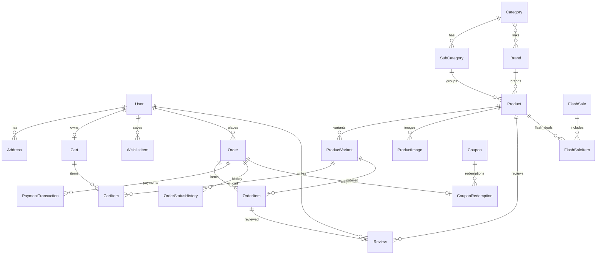
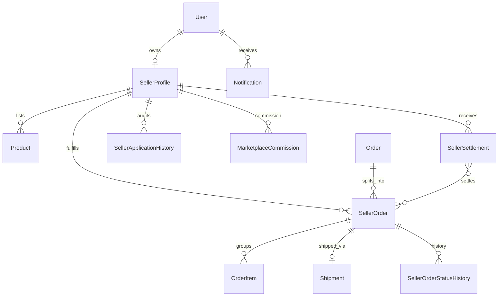

# ShopHaat — Multi-Vendor E-Commerce Marketplace

A full-stack multi-vendor e-commerce platform built with **Django REST Framework** and **React**. ShopHaat provides a unified marketplace where customers can discover products, approved sellers can manage their stores, and administrators can oversee marketplace operations.

**Live Demo:** [https://shop-haat.vercel.app/](https://shop-haat.vercel.app/)

**Source Code:** [GitHub Repository](https://github.com/mahmudul58/ShopHaat)


---

## Table of Contents

- [Overview](#overview)
- [Key Features](#key-features)
- [Technology Stack](#technology-stack)
- [Screenshots](#screenshots)
- [Getting Started](#getting-started)
- [Environment Configuration](#environment-configuration)
- [API Overview](#api-overview)
- [Project Structure](#project-structure)
- [Database Design](#database-design)
- [Future Improvements](#future-improvements)

---

## Overview

ShopHaat is a multi-vendor marketplace designed to bring multiple independent sellers together on a single e-commerce platform.

The application provides experiences tailored to its user roles:

- **Customers / Buyers:** Browse products, manage shopping carts and wishlists, apply coupons, place orders, and submit verified-purchase reviews.
- **Sellers:** Apply for a store, manage store profiles, products, variants/inventory, seller orders, earnings, and notifications through a dedicated Seller Center.
- **Staff & Administrators:** Oversee platform operations, including seller approvals, product listings, customer and seller orders, flash sales, commissions, settlements, coupons, platform settings, and analytics.

The platform follows a decoupled architecture, with Django REST Framework powering the backend API and React providing the frontend SPA experience.

---

## Key Features

### Customer / Buyer

- **Product Discovery:** Browse products across categories, subcategories, brands, flash sales, and seller storefronts (`/stores/:slug`).
- **Smart Search:** Live debounced autocomplete search dropdown with product thumbnails and pricing.
- **Product Details:** View product galleries, variant selection (size/color), stock availability, specifications, and approved customer reviews.
- **Shopping Cart & Wishlist:** Persistent cart and wishlist synchronized with the backend API.
- **Checkout:** Streamlined checkout flow (Address, Order summary, Payment) supporting Cash on Delivery (`COD`) and Simulated Online Payment (`SIMULATED_ONLINE`).
- **Order Management:** View order history, track order status timelines, cancel eligible orders, and request returns.
- **Discounts:** Preview and apply coupon codes during checkout.
- **Responsive UI:** Optimized shopping experience across desktop and mobile devices.

### Seller

- **Seller Center:** Dedicated dashboard with analytics charts, earnings breakdown, settlement history, and notifications.
- **Storefront Profile:** Manage store branding (logo, banner, description) and business details.
- **Product & Variant Management:** Create, update, and delete products, variants (SKU, size, color, price override), and images.
- **Inventory & Order Fulfillment:** Track stock levels and manage seller-side order statuses (`CONFIRMED` → `PROCESSING` → `READY_TO_SHIP` → `HANDED_OVER`).
- **Seller Approval Workflow:** Structured onboarding (`PENDING`, `APPROVED`, `REJECTED`, `SUSPENDED`) with audit history and verified seller indicators on product cards.

### Administrator & Staff

- **Admin Console:** Centralized dashboard with platform analytics and top-product insights (`admin` role), plus order and product management (`staff` & `admin`).
- **Seller & Settlement Management:** Review seller applications, manage seller statuses, configure global/category/seller commission rates, and generate payouts/settlements.
- **Marketplace Operations:** Monitor customer orders, seller order transitions, and shipment tracking.
- **Catalog & Promotions:** Manage categories, subcategories, brands, flash sales, coupons, and platform-wide settings (shipping fees, default commission, currency).
- **Review Moderation API:** Approve or reject submitted customer reviews via backend moderation endpoints (`/api/v1/admin/reviews/`).

### Backend & Security

- **JWT Authentication:** Access tokens kept in memory on the frontend, paired with `httpOnly` refresh-token cookies, token rotation, and blacklisting via SimpleJWT.
- **Role-Based Access Control (RBAC):** Distinct permission boundaries across `customer`, `seller`, `staff`, and `admin` roles.
- **Rate Throttling:** Scoped DRF throttling on authentication, password reset, order placement, and seller applications.
- **Nested & Filterable API:** DRF endpoints with `django-filter`, search, ordering, pagination, and `drf-nested-routers`.
- **Media & Static Serving:** Cloudinary integration for uploaded media and WhiteNoise for static assets.
- **CORS & CSRF Protection:** Configured origin allowlists for cross-origin frontend-backend deployment (Vercel + Render).

---

## Technology Stack

### Frontend

| Technology | Purpose |
|---|---|
| React 18 (`18.3`) | Component-based user interface |
| Vite 5 (`5.4`) | Development server, API proxy, and bundler |
| React Router v6 (`6.26`) | Client-side routing and role-based route guards |
| Tailwind CSS v3 (`3.4`) | Utility-first styling and responsive layouts |
| Axios (`1.7`) | HTTP client with automatic JWT refresh interceptors |
| React Helmet Async (`3.0`) | Per-page metadata and SEO tags |
| React Icons (`5.3`) | UI iconography |

### Backend

| Technology | Purpose |
|---|---|
| Python (`3.10+`) | Backend programming language |
| Django 5.0 (`5.0.9`) | Web framework and ORM |
| Django REST Framework (`3.15.2`) | RESTful API development |
| SimpleJWT (`5.3.1`) | JWT authentication with refresh rotation & blacklisting |
| django-filter (`24.3`) | Query filtering |
| drf-nested-routers (`0.94.1`) | Nested API resource routing |
| django-cors-headers (`4.4.0`) | Cross-origin resource sharing |
| python-decouple (`3.8`) & dj-database-url (`3.1.2`) | Environment and database configuration |
| Cloudinary & WhiteNoise | Media storage and static file serving |
| Gunicorn (`26.2.0`) | Production WSGI server |
| PostgreSQL / SQLite | PostgreSQL in production; SQLite supported for local dev |

---

## Screenshots

### 1. Homepage


The main storefront featuring promotional banners, deals, and product categories.

### 2. Product Catalog


Product browsing with search, filtering, sorting, and category navigation.

### 3. Product Details


Detailed product information, image gallery, variant selection, specifications, and customer reviews.

### 4. Shopping Cart


Manage selected products, quantities, and review cart totals before checkout.

### 5. Checkout


Checkout experience with shipping address selection, coupon application, and payment options.

### 6. Seller Dashboard


A dedicated dashboard for managing products, inventory, orders, earnings, and store activities.

### 7. Admin Dashboard


Centralized marketplace administration and platform-wide management.

---

## Getting Started

Follow the instructions below to run ShopHaat on your local machine.

### Prerequisites

Make sure you have the following installed:

- Python 3.10 or later
- Node.js 18 or later
- npm
- Git
- PostgreSQL (optional for local dev; `backend/.env.example` defaults to SQLite)

### 1. Clone the Repository

```bash
git clone https://github.com/mahmudul58/ShopHaat.git
cd ShopHaat
```

### 2. Backend Setup

Navigate to the backend directory:

```bash
cd backend
```

Create and activate a virtual environment:

```bash
python -m venv venv

# macOS / Linux
source venv/bin/activate

# Windows
venv\Scripts\activate
```

Install the required dependencies:

```bash
pip install -r requirements.txt
```

Configure the environment variables:

```bash
cp .env.example .env
```

Update `SECRET_KEY`, database credentials (`DATABASE_URL`), and Cloudinary credentials in `.env` as needed.

Run database migrations:

```bash
python manage.py migrate
```

Create an administrator account (optional):

```bash
python manage.py createsuperuser
```

Start the development server:

```bash
python manage.py runserver
```

Backend API:

```text
http://localhost:8000/
```

### 3. Frontend Setup

Open a new terminal and navigate to the frontend directory:

```bash
cd frontend
```

Configure the environment variables:

```bash
cp .env.example .env
```

Verify `VITE_API_BASE_URL` in `.env` (defaults to `http://localhost:8000/api/v1`).

Install dependencies:

```bash
npm install
```

Start the development server:

```bash
npm run dev
```

Frontend application:

```text
http://localhost:5173/
```

---

## Environment Configuration

ShopHaat uses environment variables to manage application settings and service configurations.

### Backend — `backend/.env`

| Variable | Example | Description |
|---|---|---|
| `SECRET_KEY` | `change-me-in-production` | Django cryptographic secret key |
| `DEBUG` | `True` | Enables or disables debug mode |
| `ALLOWED_HOSTS` | `localhost,127.0.0.1` | Comma-separated allowed hostnames |
| `DATABASE_URL` | `sqlite:///db.sqlite3` | Database URL (SQLite for dev, PostgreSQL for production) |
| `CORS_ALLOWED_ORIGINS` | `http://localhost:5173` | Allowed frontend origins |
| `CSRF_TRUSTED_ORIGINS` | `http://localhost:5173` | Trusted origins for cross-origin cookie/POST requests |
| `CLOUDINARY_CLOUD_NAME` | `your_cloud_name` | Cloudinary cloud name for media uploads |
| `CLOUDINARY_API_KEY` | `your_api_key` | Cloudinary API key |
| `CLOUDINARY_API_SECRET` | `your_api_secret` | Cloudinary API secret |

### Frontend — `frontend/.env`

| Variable | Example | Description |
|---|---|---|
| `VITE_API_BASE_URL` | `http://localhost:8000/api/v1` | Backend API v1 base URL |

**Note:** When deploying to production, set `DEBUG=False`, configure a strong `SECRET_KEY`, point `DATABASE_URL` to PostgreSQL, and restrict `ALLOWED_HOSTS`, `CORS_ALLOWED_ORIGINS`, and `CSRF_TRUSTED_ORIGINS` to your production domains.

---

## API Overview

ShopHaat provides RESTful APIs through Django REST Framework.

All v1 API endpoints are mounted under `/api/v1/` and return JSON responses (with health check probes at `/api/health/`, `/health/`, and `/health/db/`).

### Authentication

JWT authentication is implemented using SimpleJWT (`apps.accounts`).

| Endpoint | Purpose |
|---|---|
| `/api/v1/auth/register/` | Register a new customer account |
| `/api/v1/auth/login/` | Authenticate and obtain access token + refresh cookie |
| `/api/v1/auth/refresh/` | Rotate refresh token and issue a new access token |
| `/api/v1/auth/logout/` | Blacklist refresh token and clear auth cookie |
| `/api/v1/auth/profile/` | View or update authenticated user profile |
| `/api/v1/auth/addresses/` | Manage saved shipping/billing addresses |

### API Modules

| Module | Endpoint Prefix(es) | Description |
|---|---|---|
| Accounts | `/api/v1/auth/` | Registration, JWT login/refresh/logout, password reset, profile, addresses |
| Catalog | `/api/v1/categories/`, `/api/v1/subcategories/`, `/api/v1/brands/`, `/api/v1/products/`, `/api/v1/flash-sales/` | Categories, brands, products (nested `variants/` & `images/`), flash sales |
| Cart | `/api/v1/cart/` | Shopping cart detail, cart items (`items/`), coupon preview (`apply-coupon/`) |
| Orders & Analytics | `/api/v1/orders/`, `/api/v1/shipping-methods/`, `/api/v1/admin/orders/`, `/api/v1/admin/analytics/summary/` | Checkout, customer order tracking/cancellation/returns, admin order management & analytics |
| Coupons | `/api/v1/admin/coupons/` | Admin coupon CRUD and management |
| Reviews | `/api/v1/products/<slug>/reviews/`, `/api/v1/admin/reviews/` | Product reviews for verified purchases and admin moderation |
| Wishlist | `/api/v1/wishlist/` | User wishlist management |
| Marketplace | `/api/v1/seller/`, `/api/v1/stores/<slug>/`, `/api/v1/notifications/`, `/api/v1/admin/sellers/`, `/api/v1/admin/seller-orders/`, `/api/v1/admin/settlements/`, `/api/v1/admin/commissions/`, `/api/v1/admin/shipments/`, `/api/v1/admin/settings/` | Seller onboarding, storefronts, seller orders, shipments, commissions, settlements, notifications, platform settings |

---

## Project Structure

The repository follows a separated frontend and backend architecture.

```text
ShopHaat/
│
├── backend/
│   ├── apps/
│   │   ├── accounts/       # Custom User model, addresses, JWT auth
│   │   ├── catalog/        # Products, variants, images, categories, brands, flash sales
│   │   ├── cart/           # Shopping cart and cart items
│   │   ├── orders/         # Orders, shipping methods, payment transactions, analytics
│   │   ├── coupons/        # Discount coupons and redemptions
│   │   ├── reviews/        # Verified-purchase ratings and reviews
│   │   ├── wishlist/       # User wishlists
│   │   ├── marketplace/    # Sellers, seller orders, shipments, commissions, settlements
│   │   └── core/           # Permissions, pagination, exception handler, middleware
│   │
│   ├── config/             # Django settings, URL routing, DemoProtectMiddleware
│   ├── build.sh            # Render build script
│   ├── manage.py
│   └── requirements.txt
│
├── frontend/
│   ├── src/
│   │   ├── pages/          # Public, customer dashboard, seller center, and admin pages
│   │   ├── components/     # Reusable UI components by domain
│   │   ├── context/        # Global state (Auth, Cart, Wishlist, Toast)
│   │   ├── hooks/          # Custom React hooks
│   │   ├── services/       # Axios API client and domain service modules
│   │   ├── router/         # Application routing and role guards
│   │   └── utils/          # Currency, delivery, and shared helpers
│   │
│   ├── index.html
│   ├── package.json
│   ├── vercel.json
│   └── vite.config.js
│
└── Screenshots/            # Application screenshots
```

---

## Database Design

ShopHaat uses PostgreSQL in production (and supports SQLite for local development).

The database is organized around core e-commerce operations and multi-vendor marketplace functionality.

### 1. Core Storefront, Cart & Orders

This ER diagram illustrates the relationships between users, products, categories, shopping carts, orders, payments, coupons, and reviews.



### 2. Multi-Vendor Marketplace & Fulfillment

This ER diagram represents seller management, order fulfillment, shipment tracking, notifications, and seller settlements.



---

## Future Improvements

The following features are planned for future development to enhance the marketplace experience, payment flexibility, and overall platform capabilities.

### Payment & Checkout

- **Online Payment Integration:** Integrate real payment gateways such as SSLCommerz, bKash, and Nagad alongside the existing simulated online option.
- **Multiple Payment Options:** Support card payments, mobile financial services (MFS), and other digital payment methods.
- **Improved Checkout:** Enhance payment confirmation webhooks and failed transaction handling.

### Shopping Experience

- **Product Comparison:** Allow customers to compare multiple products based on price, specifications, and features.
- **Advanced Search & Filtering:** Introduce PostgreSQL full-text search ranking and expanded filtering options.
- **Product Recommendations:** Implement personalized product recommendations based on browsing and purchase history.
- **Recently Viewed Products:** Allow customers to revisit previously viewed products.

### Order & Delivery Management

- **Real-Time Notifications:** Introduce WebSocket/push-based real-time updates for order confirmation, payment status, and shipment progress.
- **Delivery Service Integration:** Integrate third-party courier APIs for automated shipment booking and live delivery tracking.

### Seller & Marketplace Management

- **Enhanced Inventory Management:** Introduce automated low-stock alerts and bulk inventory tools.
- **Automated Seller Settlements:** Automate periodic seller payout disbursements and commission reconciliation.
- **Seller Promotional Tools:** Allow sellers to create store-level discounts, vouchers, and campaigns.

### Performance & Security

- **Caching:** Upgrade from in-memory caching to Redis for distributed API response caching.
- **Admin Review Moderation UI:** Add a dedicated review moderation view in the React Admin Console (currently exposed via backend API and Django admin).
- **Automated Testing & CI/CD:** Expand backend and frontend test coverage and introduce CI/CD workflows.

---

**Developed by [Md. Mahmudul Islam Amit](https://github.com/mahmudul58)**

[GitHub](https://github.com/mahmudul58) | [LinkedIn](https://www.linkedin.com/in/mahmudul-islam-4a7971300/)
